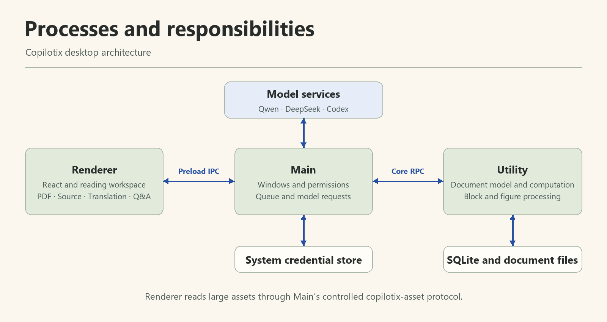
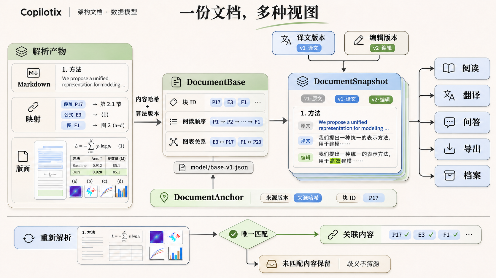
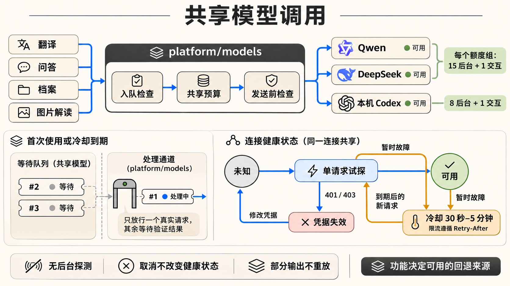

# Copilotix

<div align="center">

**讀論文，也讀懂論文。**

[下載完整版](https://github.com/Kumiko-kmk/Copilotix/releases/tag/desktop-v1.3.0) · [下載 Lite 1.0](https://github.com/Kumiko-kmk/Copilotix/releases/tag/desktop-lite-v1.0.0) · [使用指南](https://github.com/Kumiko-kmk/Copilotix/wiki) · [反饋](https://github.com/Kumiko-kmk/Copilotix/issues)

Windows x64 · 臺灣正體中文 · 本地文庫 · 中英對照 · AI 問答

</div>

Copilotix 把 PDF 解析、翻譯、閱讀與整理放在同一張桌面。展開論文件案，開啟原文與中文對照，留下批註，帶著段落和圖片繼續提問。

## 從文庫走進論文


分類瀏覽、標題搜尋、封面圖組與結構化檔案，讓每篇論文都有清晰的入口。


## 閱讀，讓線索連起來

| 對照閱讀 | 帶著上下文提問 | 留下自己的理解 |
|---|---|---|
| PDF、原文、中文與問答自由拆分 | 段落、選區和圖片加入對話 | 高亮、下劃線、筆記與雙擊編輯 |
| 內容塊定位，公式與表格呈現 | 可定位引用帶你回到論文 | 引用卡片懸停檢視、點選複製 |
| Qwen、DeepSeek 與本機 Codex | 對話與模型選擇按論文儲存 | Markdown、圖片與結果 ZIP 匯出 |

透過 [Zotero](docs/ZOTERO_BRIDGE_ZH.md) 匯入文獻，接著閱讀和整理。

<details>
<summary>檢視完整版首頁</summary>


</details>

## 選擇你的工作臺

| | 完整版 | Lite 1.0 |
|---|---|---|
| 文獻入口 | 視覺化文庫、檔案展開 | 列表側欄、標題搜尋、置頂與分類 |
| 閱讀 | PDF、原文、中文、問答四檢視 | 四檢視、雙論文分屏、獨立視窗 |
| 介面 | 完整檔案場景與首頁特效 | 靜態載入、簡潔首頁 |
| 設定 | 多金鑰與模型配置 | 服務、儲存、外觀 |
| 安裝 | 獨立程式與資料 | 獨立程式與資料，可並存 |

[完整版下載](https://github.com/Kumiko-kmk/Copilotix/releases/tag/desktop-v1.3.0) · [Lite 1.0 下載](https://github.com/Kumiko-kmk/Copilotix/releases/tag/desktop-lite-v1.0.0) · [Lite 更新說明](docs/releases/lite/1.0.0.zh-TW.md)

## 開始使用

1. 下載 `setup.exe`，按嚮導安裝。
2. 配置 MinerU Token，以及模型 API Key 或本機 Codex。
3. 匯入 PDF，開始對照閱讀。

資料儲存在本地，金鑰使用 Windows 憑據儲存。解析與 AI 功能連線你配置的服務。兩版可透過匯出／匯入轉移文獻，分別配置金鑰。

[第一篇論文](https://github.com/Kumiko-kmk/Copilotix/wiki/First-Paper) · [服務配置](https://github.com/Kumiko-kmk/Copilotix/wiki/Service-Setup) · [閱讀工作台](https://github.com/Kumiko-kmk/Copilotix/wiki/Reader-Workbench) · [資料與備份](docs/LIBRARY_MANAGEMENT_ZH.md)

## 專案結構

### 程序與職責



React 負責互動，Main 管理視窗、許可權與模型請求，Utility 擁有 SQLite 和文件計算。Core RPC 傳遞小型描述，大資源經受控協議讀取。

### 一份文件，多種檢視



原始內容、譯文和使用者編輯分別保留版本，組合為共享快照。閱讀、翻譯、問答、匯出和檔案沿用同一套塊身份與對映；重新解析後只關聯唯一匹配的內容。

### 共享模型呼叫



各功能保留自己的提示詞，共享連線檢查、排隊預算與用量記錄。故障連線進入冷卻，後續請求快速跳過；恢復由新請求觸發單次試探。

開發環境：**Node.js 24.19.0 · pnpm 11.19.0**。

```powershell
pnpm install --frozen-lockfile
pnpm desktop:dev
pnpm --dir desktop dev:lite
```

[架構](docs/ARCHITECTURE_ZH.md) · [開發與測試](docs/DESKTOP_DEVELOPMENT_ZH.md) · [釋出](docs/DESKTOP_RELEASE_ZH.md) · [貢獻](AGENTS.md) · [影象來源](docs/images/README.md)

## 許可與致謝

[MIT](LICENSE.md)。感謝 MinerU、Electron、React、PDF.js、KaTeX 等開源專案。[第三方宣告](THIRD_PARTY_NOTICES.md) · [安全反饋](docs/SECURITY.md)
