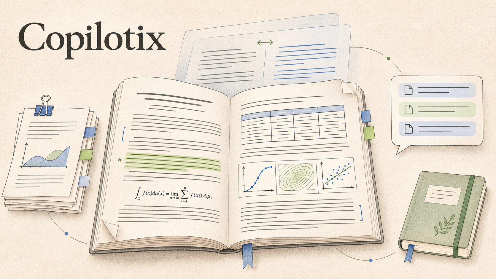
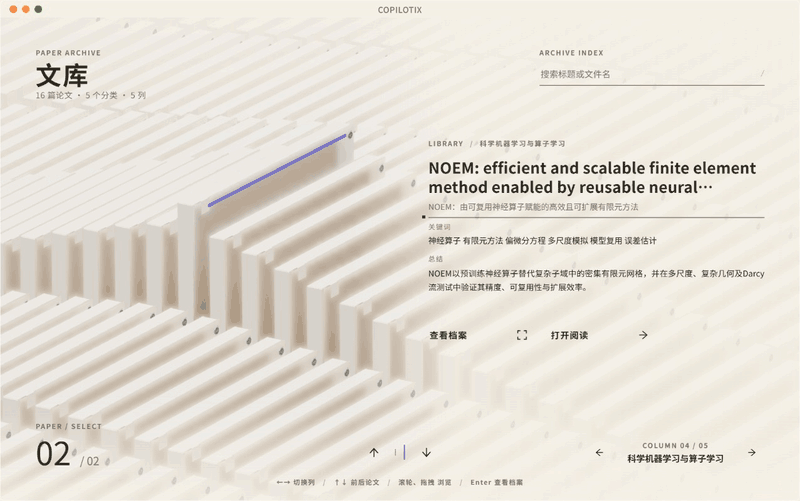
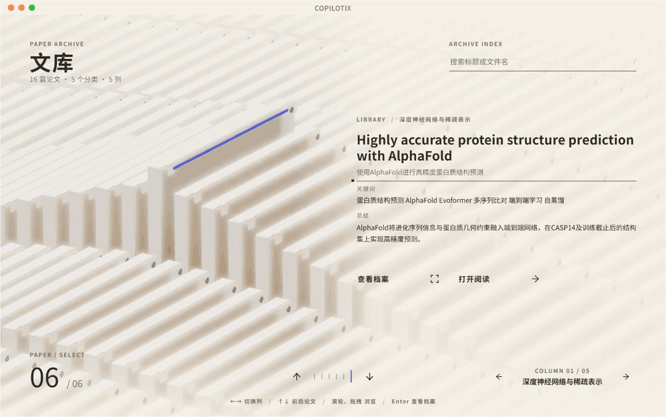
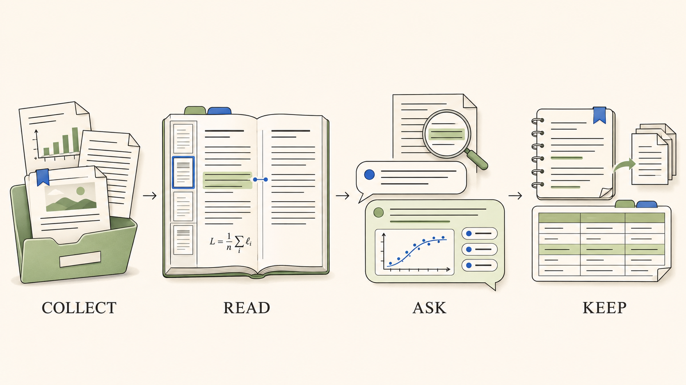
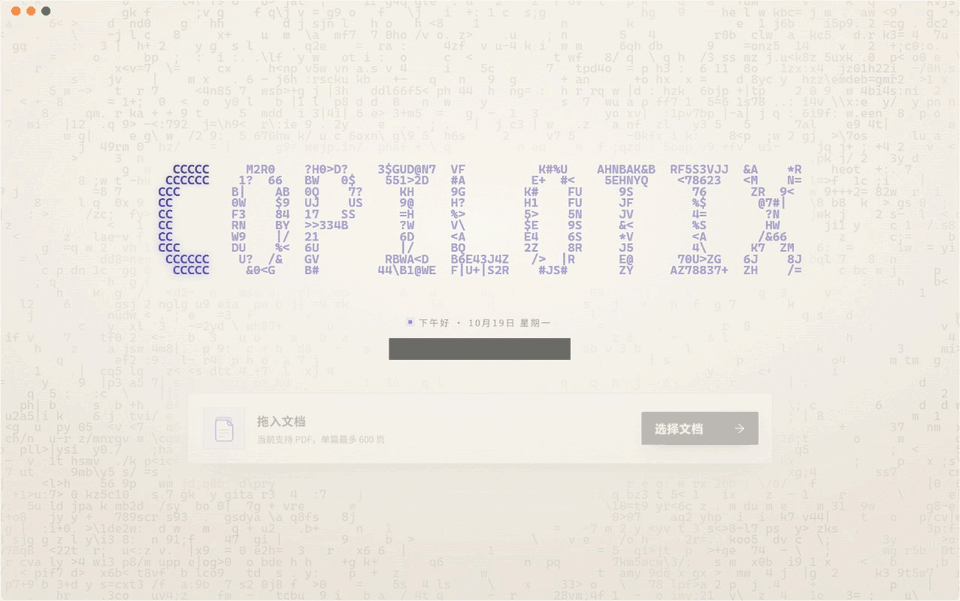
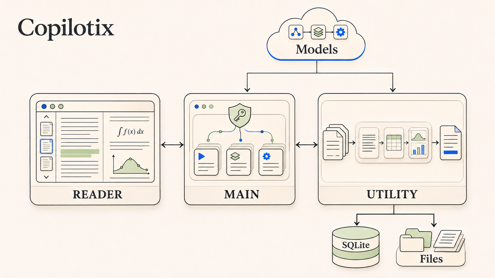

<div align="center">

**读论文，也读懂论文。**

[下载完整版](https://github.com/Kumiko-kmk/Copilotix/releases/tag/desktop-v1.3.0) · [下载 Lite 1.0](https://github.com/Kumiko-kmk/Copilotix/releases/tag/desktop-lite-v1.0.0) · [使用指南](https://github.com/Kumiko-kmk/Copilotix/wiki) · [反馈](https://github.com/Kumiko-kmk/Copilotix/issues)

Windows x64 · 本地文库 · 中英对照 · AI 问答

</div>

Copilotix 把 PDF 解析、翻译、阅读与整理放在同一张桌面。展开论文档案，打开原文与中文对照，留下批注，带着段落和图片继续提问。

## 从文库走进论文



分类浏览、标题搜索、封面图组与结构化档案，让每篇论文都有清晰的入口。



## 阅读，让线索连起来



| 对照阅读 | 带着上下文提问 | 留下自己的理解 |
|---|---|---|
| PDF、原文、中文与问答自由拆分 | 段落、选区和图片加入对话 | 高亮、下划线、笔记与双击编辑 |
| 内容块定位，公式与表格呈现 | 可定位引用带你回到论文 | 引用卡片悬停查看、点击复制 |
| Qwen、DeepSeek 与本机 Codex | 对话与模型选择按论文保存 | Markdown、图片与结果 ZIP 导出 |

通过 [Zotero](docs/ZOTERO_BRIDGE_ZH.md) 导入文献，接着阅读和整理。

<details>
<summary>查看完整版首页</summary>



</details>

## 选择你的工作台

| | 完整版 | Lite 1.0 |
|---|---|---|
| 文献入口 | 可视化文库、档案展开 | 列表侧栏、标题搜索、置顶与分类 |
| 阅读 | PDF、原文、中文、问答四视图 | 四视图、双论文分屏、独立窗口 |
| 界面 | 完整档案场景与首页特效 | 静态加载、简洁首页 |
| 设置 | 多密钥与模型配置 | 服务、存储、外观 |
| 安装 | 独立程序与数据 | 独立程序与数据，可并存 |

[完整版下载](https://github.com/Kumiko-kmk/Copilotix/releases/tag/desktop-v1.3.0) · [Lite 1.0 下载](https://github.com/Kumiko-kmk/Copilotix/releases/tag/desktop-lite-v1.0.0) · [Lite 更新说明](docs/releases/lite/1.0.0.zh-CN.md)

## 开始使用

1. 下载 `setup.exe`，按向导安装。
2. 配置 MinerU Token，以及模型 API Key 或本机 Codex。
3. 导入 PDF，开始对照阅读。

资料保存在本地，密钥使用 Windows 凭据存储。解析与 AI 功能连接你配置的服务。两版可通过导出／导入转移文献，分别配置密钥。

[第一篇论文](https://github.com/Kumiko-kmk/Copilotix/wiki/First-Paper) · [服务配置](https://github.com/Kumiko-kmk/Copilotix/wiki/Service-Setup) · [阅读工作台](https://github.com/Kumiko-kmk/Copilotix/wiki/Reader-Workbench) · [数据与备份](docs/LIBRARY_MANAGEMENT_ZH.md)

## 项目结构



React 构建阅读界面，Electron Main 管理窗口与调度，Utility 处理文档模型、SQLite 和计算任务。统一文档模型连接阅读、编辑、翻译与导出，共享模型层管理供应商调用。

开发环境：**Node.js 24.19.0 · pnpm 11.19.0**。

```powershell
pnpm install --frozen-lockfile
pnpm desktop:dev
pnpm --dir desktop dev:lite
```

[架构](docs/ARCHITECTURE_ZH.md) · [开发与测试](docs/DESKTOP_DEVELOPMENT_ZH.md) · [发布](docs/DESKTOP_RELEASE_ZH.md) · [贡献](AGENTS.md) · [图像来源](docs/images/README.md)

## 许可与致谢

[MIT](LICENSE.md)。感谢 MinerU、Electron、React、PDF.js、KaTeX 等开源项目。[第三方声明](THIRD_PARTY_NOTICES.md) · [安全反馈](docs/SECURITY.md)
