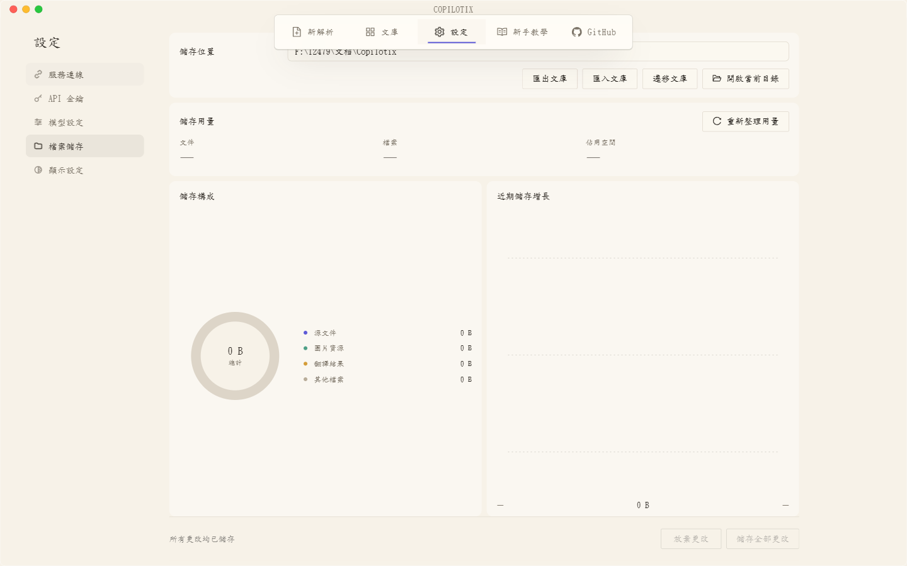

# 文件庫備份、恢復與遷移

入口：設定 → 檔案儲存 → 文件庫管理。

截圖使用臨時測試文件庫。

- 備份：選擇父目錄，生成 Copilotix-backup-日期-標識 資料夾。包含資料庫、全部文件產物、標註、翻譯快取及已儲存設定。API 金鑰由系統憑據管理，不進入備份。
- 恢復：選擇包含 manifest.json 的完整備份資料夾。校驗成功後先備份當前庫至 userData/library-recovery，再複製源文件至新目錄，透過單個資料庫事務替換資料，完成後重啟。舊文件保留，不自動刪除；可從恢復前備份再次恢復。
- 遷移：選擇空目錄，複製並校驗每個文件，再用單個資料庫事務切換全部 storage_path 和 outputRoot，完成後重啟。舊檔案保留。資料庫仍在應用 userData 中。
- 修改文件儲存位置僅影響未來任務，與遷移全部文件是不同操作。
- 任務處於 queued/running/retry-wait 時拒絕管理操作，請等待任務結束。
- 首版恢復要求 schema_migrations 及實際資料庫結構與當前版本一致；不做隱式跨版本轉換。
- 資料夾必須完整儲存。備份不是隻包含 Markdown 的結果 ZIP。
- 更換電腦後，API 金鑰需要重新配置。解析/翻譯服務的歷史用量統計 JSON 不屬於文件庫備份。

實現約束：
1. Renderer 只傳 action；路徑透過 Main 原生目錄對話方塊獲取，並對恢復/遷移二次確認。
2. Main IPC 維護鎖阻止重疊讀寫，Utility 在現有持久化序列佇列執行 library:manage。
3. SQLite 用 VACUUM INTO 生成一致副本；manifest v1 記錄 SHA-256、位元組數和文件 ID。
4. 拒絕越界路徑、符號連結、重複路徑、清單外檔案、損壞資料庫和活動作業。
5. 檔案 fsync 與校驗先於資料庫切換；恢復使用事務，不替換正在開啟的 SQLite 檔案。
6. 操作失敗前未切換時，原庫不變。磁碟可能保留 .copilotix-* 暫存目錄，不能把它當完整備份。確認不再需要後由使用者清理。
7. 成功切換後維護鎖持續到重啟，防止舊快取繼續寫入。

驗證範圍以本次實際測試結果為準。相關測試：libraryMaintenance.test.ts、libraryAccessGate.test.ts、SettingsPage.test.tsx；介面用例由顯式 UI 迴歸執行。

## 資料庫升級保護與恢復

已有資料庫需要升級時，應用先在資料庫同目錄生成 `*.pre-migration-v*.sqlite3` 快照，完成落盤和完整性校驗後才執行遷移。一次啟動中的全部待執行遷移共用事務，失敗則全部回滾。發現資料庫版本高於應用支援版本時拒絕開啟，請使用匹配或更新的應用版本。

資料庫快照僅包含資料庫，不等同上述完整文件庫備份。通常遷移失敗後原庫已回滾，無需立即替換檔案。確需從快照恢復時：

1. 完全退出應用（包括托盤），保留整個應用資料目錄及原文件目錄的副本。
2. 使用能讀取該快照版本的應用。將現有主資料庫及同名 `-wal`、`-shm` 檔案一併移到獨立保留目錄，不要直接覆蓋仍在使用的檔案。
3. 將選定快照複製為原主資料庫名 `copilotix-desktop-v2.sqlite3`，保留原快照。不要將舊 WAL 檔案與快照混用。
4. 啟動應用，核對文件列表和實際檔案；若仍失敗，保留現場並提交脫敏錯誤資訊。

預設資料目錄為 `%APPDATA%\Copilotix-Translation-v2`。快照會保留歷史設定資料，請按私有資料保護；它與不包含憑據的可遷移文件庫備份用途不同。

## 文獻問答記錄

每篇文獻的 `notes/notes.v1.json` 儲存閱讀器便利貼筆記（原文／譯文錨點與正文），經 Utility data 通道原子讀改寫，隨完整文獻目錄備份、恢復和遷移，不新增 migration；舊版本忽略此目錄。

每篇文獻的 `chat/` 儲存對話輪次與 `session.json`（草稿、固定選區、模型）。記錄隨完整文獻目錄備份、恢復和遷移，不包含系統 API 憑據；維護前先停止問答並等待落盤。清空對話只刪當篇對話輪次，保留其他文獻和原始檔。解除安裝預設保留，明確選擇清除文庫時才按既有已登記目錄清理。

## AI 結構化解讀

文獻內 `insight/insight.v1.json` 隨完整文獻目錄備份、恢復與遷移，由既有 manifest v1 記錄檔案雜湊，不新增 migration。維護前取消生成並等待原子寫入完成；失敗保持既有文庫。舊庫無檔案視為尚未生成，正文 artifact revision 改變時保留結果並標示過期。解除安裝預設保留；明確清理文庫時，唯讀清單包含解讀與 `.pending-*` 殘留，沿用路徑／連結與確認後變更校驗。詳見 [AI 解讀契約](PAPER_INSIGHT_ZH.md)。
