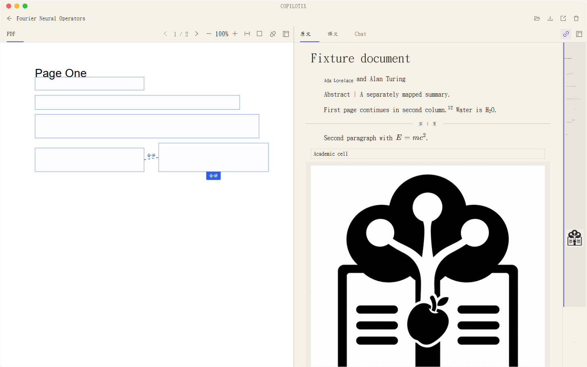

# 處理第一篇論文

**適用版本：1.2.0。** 按匯入 → 解析 → 翻譯 → 對照閱讀 → 問答／匯出的順序完成一次流程。

## 1. 準備服務與儲存位置

- 按[服務配置](https://github.com/Kumiko-kmk/Copilotix/wiki/Service-Setup)驗證並儲存 MinerU Token，以及需要的翻譯／問答服務。
- 在「設定 → 模型設定」確認啟用來源和順序，預設 Qwen → DeepSeek → Bing → TranSmart。
- 在「設定 → 檔案儲存」確認文獻儲存位置。更改位置隻影響新任務，搬移舊文獻請使用文庫遷移。

## 2. 匯入 PDF

從首頁或「新解析」拖入一個或多個 PDF，也可點選「選擇文件」。檢查列表和命名選項，再點選「開始解析」。

- 正式支援 PDF；當前不直接匯入 Markdown。
- 「跳過重複檔案」預設啟用，按檔案內容識別重複項，改名不會改變檔案內容。
- 本地限制為單檔案 **200 MiB、600 頁**；服務端還可能有額度、頁數等限制。
- 解析成功後自動安排翻譯，不需手工再啟動。

## 3. 檢視進度與開啟文獻

全部論文在「文庫」中瀏覽、搜尋與開啟；準備完成後可展開檔案，檢視摘要、背景、結論和討論，再點選封面或「開啟閱讀」進入閱讀器。失敗或部分完成時，在閱讀器頂欄點「重試」；頂欄也可刪除論文。

「部分完成」表示仍有未成功的翻譯單元，失敗部分保留原文；可以先閱讀已有結果，再重試失敗部分。公式、程式碼等受保護內容也可能維持原文，需結合任務狀態判斷。

## 4. 對照閱讀與標註

*真實示例文獻：左側 PDF，右側中文 Markdown。*

預設左側 PDF，右側原文、中文和 AI 問答頁籤。右鍵頁籤可拆分分組，同時顯示原文和中文；版面配置會儲存。JSON 不再是閱讀頁籤，底層版面檔案仍保留。

原文與中文預設按內容塊同步滾動，PDF 可獨立開啟同步。點選內容塊可以定位來源；定位依賴解析對映質量。調整欄寬或 PDF 縮放時保留當前頁碼與頁內位置。

在原文／中文中選擇文字，可新增熒光筆、下劃線或「新增到對話」。原文與中文標註分別儲存；「新增到對話」加入選區，不會自動切走當前頁籤。

拆分、拖動、最大化和快捷鍵見[閱讀工作台](https://github.com/Kumiko-kmk/Copilotix/wiki/Reader-Workbench)。

## 5. 向當前文獻提問

切換「AI 問答」，等待本地索引準備完成，選擇已配置的 Qwen 或 DeepSeek，輸入問題。首次傳送確認接收服務和傳送內容；問題、近期對話、選區及相關文獻片段會發給該服務。

例如可問「解釋論文中縮放點積注意力的作用」，也可先選中某一段再提問。有效來源引用可以定位回閱讀檢視，應繼續核對原文。聊天、草稿、選區與模型按文獻儲存，重開後恢復。

詳細操作及清空／撤銷授權見[論文 AI 問答](https://github.com/Kumiko-kmk/Copilotix/wiki/Paper-AI-Chat)。

## 6. 匯出、備份或繼續閱讀

閱讀器可另存當前 Markdown、匯出結果 ZIP 或開啟輸出目錄。Markdown 另存會生成標準投影，並複製關聯圖片到相鄰目錄，分享時保留這些圖片。

**結果 ZIP 包含文獻產物及已有 `chat/` 檔案**，分享前檢查聊天、草稿和選區；它不包含應用資料庫或憑據，不是完整文庫備份。備份、恢復、遷移和具體檔案結構見[本地資料與匯出](https://github.com/Kumiko-kmk/Copilotix/wiki/Local-Data-and-Export)。

下次從文庫繼續閱讀，聊天記錄不會因再次開啟而清空。升級／解除安裝前等待任務結束並從托盤退出，預設保留個人資料，見[安裝與升級](https://github.com/Kumiko-kmk/Copilotix/wiki/Installation-and-Upgrade)。
