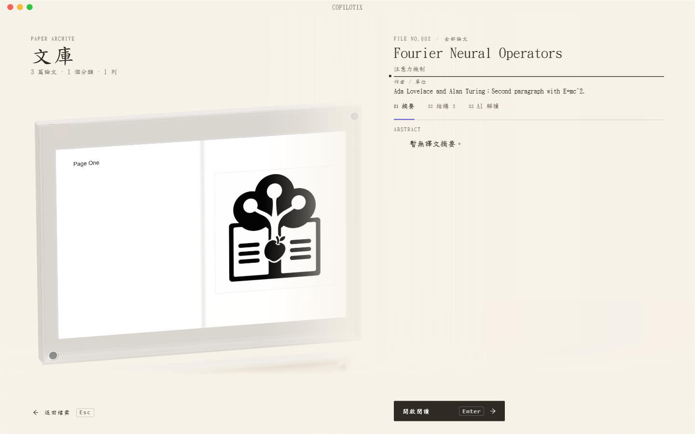

# Copilotix 使用指南

**適用版本：1.2.0 · Windows x64**

Copilotix 將 PDF 解析、中文翻譯、原文對照與論文 AI 問答放進同一個桌面閱讀工作台。文獻產物和對話儲存在本地；解析、翻譯和問答按實際配置呼叫線上服務。

[1.2.0 版本說明](https://github.com/Kumiko-kmk/Copilotix/blob/master/docs/releases/1.2.0.zh-TW.md) · [倉庫 README](https://github.com/Kumiko-kmk/Copilotix#readme)

*獨立測試文庫的正體中文畫面。*

## 從這裡開始

1. [安裝與升級](https://github.com/Kumiko-kmk/Copilotix/wiki/Installation-and-Upgrade)
2. [配置服務](https://github.com/Kumiko-kmk/Copilotix/wiki/Service-Setup)：MinerU Token、翻譯來源及問答憑據。
3. [處理第一篇論文](https://github.com/Kumiko-kmk/Copilotix/wiki/First-Paper)：匯入、任務進度、閱讀、標註與匯出。

## 1.2.0 的閱讀方式

| 你想做什麼 | 指南 |
| --- | --- |
| 同時檢視 PDF、原文和中文；拖動、拆分與最大化檢視 | [閱讀工作台](https://github.com/Kumiko-kmk/Copilotix/wiki/Reader-Workbench) |
| 向當前文獻提問，加入選區並檢視引用；重開後繼續對話 | [論文 AI 問答](https://github.com/Kumiko-kmk/Copilotix/wiki/Paper-AI-Chat) |
| 查詢本地檔案、匯出 Markdown／ZIP、備份和遷移文庫 | [本地資料與匯出](https://github.com/Kumiko-kmk/Copilotix/wiki/Local-Data-and-Export) |
| 排查憑據、任務、聊天恢復、版面配置或圖片問題 | [常見問題](https://github.com/Kumiko-kmk/Copilotix/wiki/FAQ) |

新版提供 PDF、原文、中文、AI 問答四個檢視。JSON 頁面已移除，版面檔案仍作為定位與匯出的底層資料保留。PDF 去掉額外外框、右側／底部和頁間留白，調整寬度或縮放時保留頁碼與頁內位置；正文排版也更緊湊。

問答支援 Qwen、DeepSeek 的預設模型及本機 Codex，使用「服務連線」中相應憑據，獨立於翻譯模型選擇。每篇文獻的回答、草稿、選區與模型儲存在對應 `chat/` 目錄，重新開啟恢復。

## 使用前瞭解

- 正式匯入格式為 **PDF**，Markdown 是解析、翻譯和匯出產物。
- 程式不提供第三方 API Key。解析上傳 PDF 到 MinerU；翻譯向實際來源傳送文字；問答首次傳送前說明所選服務和資料範圍。
- 舊版安裝包暫停公開下載。
- 結果 ZIP 包含已有聊天檔案；分享前檢查對話、草稿及選區。完整文庫備份不含系統 API 憑據。

技術與維護說明見 [工程文件索引](https://github.com/Kumiko-kmk/Copilotix/blob/master/docs/README.md)。Wiki 的版本化原始檔見 [docs/wiki](https://github.com/Kumiko-kmk/Copilotix/tree/master/docs/wiki)。
