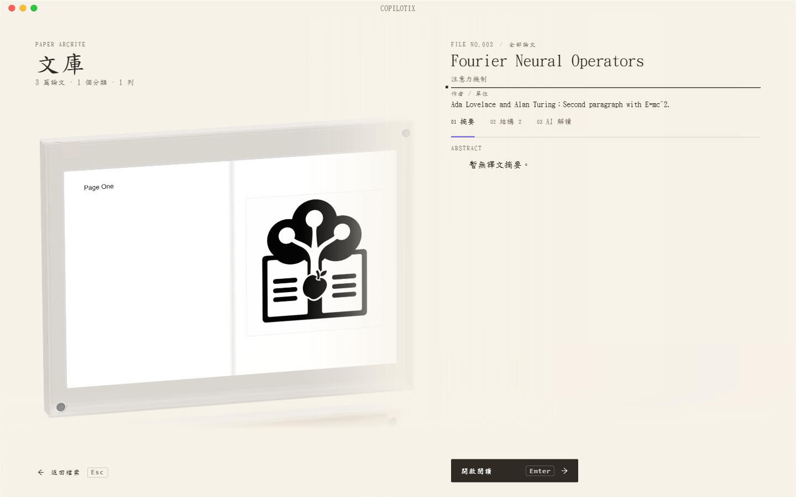

# 安裝、升級與解除安裝

**適用版本：1.2.0 · Windows x64**

## 下載與安裝檔案

從 [1.2.0 Release](https://github.com/Kumiko-kmk/Copilotix/releases/tag/desktop-v1.2.0) 下載所需檔案：

| 檔案 | 用途 |
| --- | --- |
| `setup.exe` | 獨立安裝程式，已內嵌完整程式，可直接安裝 |
| Source code | GitHub 按版本 tag 提供的原始碼 ZIP／tar.gz，供開發使用 |

從 1.2.0 起，Release 只提供安裝包與原始碼，校驗資訊保留在構建流程內部。安裝包的簽章狀態以對應 Release 說明為準，請從本倉庫下載。

## 首次安裝

1. 下載並執行 `setup.exe`，無需另外下載程式目錄或原始碼。
2. 選擇當前使用者可寫的安裝位置，按需建立桌面捷徑。
3. 完成安裝後啟動 Copilotix；桌面應用不需要 Python、CUDA 或本地解析模型。
4. 按[服務配置](https://github.com/Kumiko-kmk/Copilotix/wiki/Service-Setup)驗證並儲存憑據，再選擇文獻儲存位置。

*獨立測試文庫中的論文封面和摘要。*

安裝目錄放程式，文獻儲存位置放論文和處理產物，兩者相互獨立。程式目錄提供 `uninstall.exe`。

## 覆蓋升級

1. 等待解析、翻譯及問答結束；需要時先[建立完整文庫備份](https://github.com/Kumiko-kmk/Copilotix/wiki/Local-Data-and-Export)。
2. 從系統匣退出 Copilotix。關閉主視窗可能僅隱藏到托盤。
3. 執行新版 Setup 完成覆蓋安裝。
4. 啟動後檢查文獻、產物、聊天和設定；版本以「關於」或正式釋出記錄為準。

覆蓋升級保留個人資料，不會因為安裝到新位置而遷移舊文庫。安裝程式檢測程式仍執行時會提示退出，不應強制結束背景任務。

## 解除安裝與資料保留

解除安裝預設保留文獻、應用資料及系統憑據，可供重灌後繼續使用。只有確實要清除個人資料時，才勾選清除選項並完成第二次原生確認。覆蓋升級和靜默解除安裝不會觸發該清理。

如果電腦上還有需要保留的文獻或聊天，先確認備份和文庫路徑，再選擇清理。重灌到同一電腦時已有憑據可能仍在系統儲存；跨電腦恢復備份後需要重新配置憑據。

## 不要單獨複製程式 EXE

原始碼構建產生的 `program/Copilotix.exe` 依賴同目錄的 DLL、PAK 和 `resources/`。需要直接執行開發副本時須保留完整 `program/`；正式下載的 Setup 已嵌入執行依賴。

詳細安裝契約見倉庫的 [Windows 安裝、升級與解除安裝](https://github.com/Kumiko-kmk/Copilotix/blob/master/docs/WINDOWS_INSTALLATION_ZH.md)。
