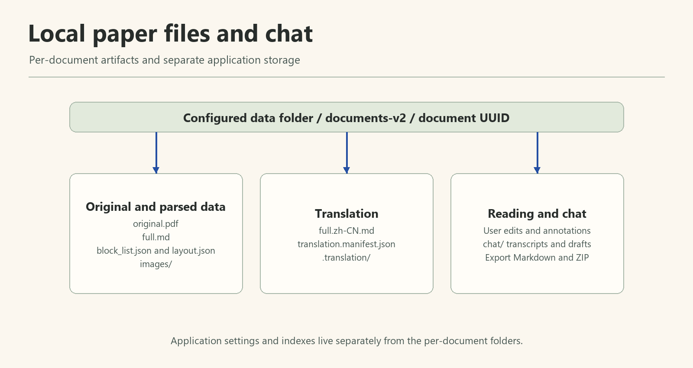

# 本地資料、匯出與文庫管理

**適用版本：1.2.0。** 文獻目錄儲存 PDF、解析產物、譯文及聊天；獨立應用資料庫儲存任務、文獻記錄等應用狀態，憑據由系統管理。



*英文示意圖說明論文產物、聊天紀錄與應用程式資料的位置。*

## 一篇文獻的檔案

在「設定 → 檔案儲存」確認文件儲存位置，也可從閱讀器開啟輸出目錄：

```text
<文件儲存位置>/documents-v2/<documentId>/
├── original.pdf                   # 原始 PDF
├── full.md                        # 解析原文
├── full.zh-CN.md                  # 中文譯文
├── layout.json                   # 版面與頁面座標
├── block_list.json               # 內容塊對映
├── content_list.json             # 可選
├── images/                       # 可選圖片資源
├── translation.manifest.json     # 譯文塊與對映
├── translation.checkpoint.json   # 翻譯進度
├── chat/                         # 問答使用後按需建立
│   ├── session.json              # 草稿、選區、模型選擇
│   └── <timestamp>-<turnId>.json  # 問題、回答、引用
└── .translation/<jobId>/plan.json # 內部翻譯計劃
```

`documentId` 是應用文獻 ID，不是原檔名或任務 ID。不是每篇文獻都已翻譯或使用問答，相應檔案可能尚未生成。

聊天記錄按文獻原子落盤，重新開啟恢復；API Key 不寫入這些檔案。底層 JSON 繼續用於定位與處理，但不再作為閱讀頁籤展示。

## 應用資料庫與憑據

預設應用資料庫位置：

```text
%APPDATA%\Copilotix-Translation-v2\copilotix-desktop-v2.sqlite3
```

資料庫與文獻儲存位置相互獨立。只複製一個文獻目錄不能完整恢復任務列表、設定及應用狀態；只備份資料庫也不能代替 PDF、圖片、譯文和聊天檔案。

API 憑據儲存在 Windows 系統憑據儲存中，不隨結果 ZIP 或完整文庫備份匯出。跨電腦恢復後重新配置憑據；同電腦重灌時系統中已保留的憑據可能仍在。

## 另存 Markdown

閱讀器選中原文／中文檢視後另存，生成標準 Markdown 投影並複製關聯圖片到相鄰資源目錄，源資料不被改寫。分享時同時保留 Markdown 和圖片目錄，並維持相對路徑。

閱讀器可以顯示 HTML 合併表格與 LaTeX 豐富結構；標準匯出面向 CommonMark／GFM 與明確數學擴充套件，目標軟體的渲染能力可能不同。另存檔案不能自動恢復任務與聊天。

## 匯出結果 ZIP

結果 ZIP 包括文獻產物與圖片，原文／譯文經標準化；排除內部 `.translation/`，不含應用資料庫和系統憑據。

**已有 `chat/` 檔案也會進入結果 ZIP，包括輪次、草稿與選區。** 分享前檢視匯出內容。只需要正文時可改為另存 Markdown 和圖片；清空應用內聊天不會刪除已經匯出的副本。

ZIP 是處理結果交付，不等同於完整文庫備份。

## 備份、恢復與遷移

使用應用內的文庫管理功能，並先等待解析、翻譯與問答結束。

| 操作 | 結果 |
| --- | --- |
| 建立備份 | 儲存資料庫、文獻產物、聊天、批註及已儲存設定，生成校驗資訊；不含系統 API 憑據 |
| 恢復備份 | 先檢查備份結構、相容性及檔案雜湊，再恢復應用記錄和檔案；保留舊文獻目錄 |
| 遷移文庫 | 複製並校驗完成後切換儲存路徑；保留舊目錄，不自動刪除 |
| 修改文件儲存位置 | 隻影響新任務，不搬移已有文獻 |

備份目錄須完整保留，不要只留下其中的資料庫或 ZIP。恢復會影響當前文庫，操作前保留當前庫的備份，並依應用提示重啟和檢查文獻。

想節省空間時，先完成遷移、重啟驗證與備份，再人工判斷舊目錄是否仍需保留。不要在任務活動期間手工改名或移動文獻目錄。

詳細相容與恢復語義見 [文庫管理指南](https://github.com/Kumiko-kmk/Copilotix/blob/master/docs/LIBRARY_MANAGEMENT_ZH.md)，解除安裝清理見[安裝與升級](https://github.com/Kumiko-kmk/Copilotix/wiki/Installation-and-Upgrade)。
