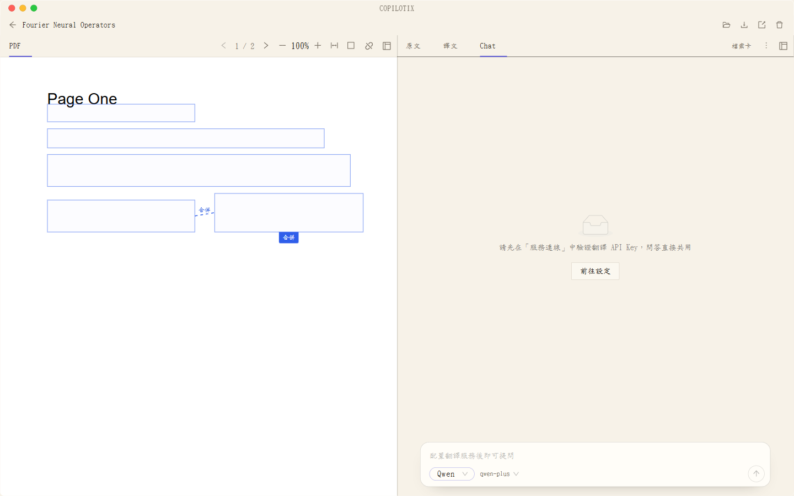

# 論文 AI 問答

**適用版本：1.2.0。** 問答圍繞當前文獻展開，回答和會話狀態儲存在該文獻的本地目錄中。



*獨立測試文庫的問答畫面，顯示尚未連線的服務設定提示。*

## 開始一次對話

1. 開啟已解析文獻，進入「AI 問答」頁籤。
2. 首次進入按需準備本地內容索引；未解析完成或索引失敗時，按提示等待或重試。
3. 在「設定 → 服務連線」驗證並儲存 Qwen／DeepSeek 憑據，在「模型設定」啟用相應來源。
4. 在問答輸入區選擇已啟用的服務商與內建模型，輸入問題。`Enter` 傳送，`Shift+Enter` 換行。
5. 首次傳送確認接收方、模型與資料範圍，選擇「同意併傳送」。
6. 檢視回答及引用，回到文獻核對關鍵結論。

憑據配置詳見[服務指南](https://github.com/Kumiko-kmk/Copilotix/wiki/Service-Setup)。Bing 與 TranSmart 僅提供翻譯，不支援此問答。

## 服務與模型

問答共用相應翻譯服務的 API 憑據，但單獨選擇問答模型，不會改動翻譯模型。當前版本只支援這些內建選擇項：

| 服務 | 問答模型 |
| --- | --- |
| Qwen | `qwen-plus`、`qwen3.8-flash`、`qwen3.8-max` |
| DeepSeek | `deepseek-flash`、`deepseek-v4-pro` |

選項可見不代表服務端當前允許呼叫，實際以帳號、地域、額度和服務商說明為準。自定義模型入口已移除；舊會話中的自定義選擇回退到預設，已有歷史輪次保留。

## 使用選區與引用

在原文／中文選擇文字，透過「新增到對話」加入固定選區；這一步不自動切換頁籤。開啟問答後，可檢查來源標籤並移除不需要的選區，再提出具體問題。

例如針對某一公式詢問符號含義，或針對某一段落要求解釋論證。回答中的有效引用可回到對應閱讀檢視。引用定位依賴文獻對映和當前版本，應對照論文判斷回答是否準確；此功能不等同於跨文獻檢索。

## 會傳送哪些資料？

所選 Qwen 或 DeepSeek 接收當前問題、近期對話、選區及相關論文片段；短論文可能傳送完整的已解析文字。首次傳送介面說明接收方和模型。更換接收服務可能需要重新確認。

本地索引和落盤不會替代外部服務的資料處理條款。API Key 由 Windows 系統憑據儲存管理，不進入聊天檔案。

## 重開後繼續聊天

```text
<文件儲存位置>/documents-v2/<documentId>/chat/
├── session.json
└── <timestamp>-<turnId>.json
```

`session.json` 儲存草稿、選區和模型選擇；輪次檔案儲存問題、完整回答與引用。不同論文分別儲存，重新開啟恢復，不會因關閉閱讀器而清空。歷史記錄按需分頁載入。

只複製論文 PDF 不能恢復聊天；保留完整文獻目錄，或使用文庫備份。具體檔案、分享和恢復語義見[本地資料與匯出](https://github.com/Kumiko-kmk/Copilotix/wiki/Local-Data-and-Export)。

## 停止、清空與撤銷授權

| 操作 | 效果 |
| --- | --- |
| 輸入區「停止」 | 停止當前回答請求 |
| 標題欄「⋯ → 清空對話」 | 清除當前文獻的已儲存對話輪次；保留草稿、選區、模型及論文產物 |
| 「⋯ → 撤銷傳送授權」 | 停止當前請求並撤銷後續傳送授權；再傳送需重新確認 |

撤銷授權不會遠端刪除服務商已收到的資料，也不會清空本地歷史。清空對話同樣不刪除已經分享的 ZIP 或其他備份中的副本。

**結果 ZIP 會包含已有聊天檔案，包括草稿和選區。** 分享前檢視匯出內容；只需分享正文時可另存 Markdown 及圖片。
