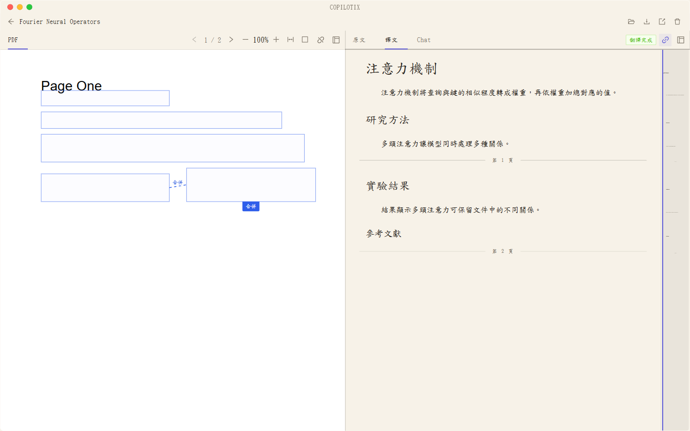

# 閱讀工作台

**適用版本：1.2.0。** 同一篇文獻可以在多個分組中對照 PDF、原文、中文和 AI 問答。

*獨立測試文庫的操作畫面，左側是 PDF，右側是正體中文譯文。*

## 分組與頁籤

預設版面配置為左側 PDF，右側原文、中文與問答頁籤。右鍵頁籤或開啟分組「⋯」選單，可以左右／上下拆分、移動到其他分組或關閉當前檢視。

- 拖動頁簽到其他分組標題欄可移動，同組拖動可排序。
- 拖到分組內容區邊緣可拆分，中間可合併；介面顯示目標預覽，空間不足時禁止該放置。
- 每個檢視只出現一次：移動的是檢視，不會複製文獻或聊天。
- 關閉後透過「+」重新開啟；最後一個可見檢視不能關閉。
- 拖動分隔線調整欄寬或上下高度。

工作台版面配置作為全域性偏好儲存，後續開啟文獻沿用該版面配置；聊天內容和選區則按文獻獨立儲存。

## 最大化與快捷鍵

雙擊頁籤或按 `Ctrl+Shift+M` 臨時最大化當前分組，按 `Esc` 還原。

| 快捷鍵 | 操作 |
| --- | --- |
| `Ctrl+1` | 顯示 PDF |
| `Ctrl+2` | 顯示原文 |
| `Ctrl+3` | 顯示中文 |
| `Ctrl+4` | 顯示 AI 問答 |
| `Ctrl+\` | 向右拆分當前檢視 |
| `Ctrl+Alt+←`／`Ctrl+Alt+→` | 移到相鄰分組 |
| `Ctrl+W` | 關閉當前檢視，保留最後一個可見檢視 |
| `Ctrl+Shift+T` | 重開最近關閉的檢視 |
| `Ctrl+Shift+M` | 最大化／還原分組 |
| `Esc` | 取消頁籤拖動或還原最大化 |

## 內容同步與來源定位

原文與中文預設開啟內容同步；PDF 預設關閉，可用所在分組標題欄的連結開關開啟。問答面板不參與滾動同步。

同步依據內容塊及塊內位置，參與者是當前各分組中可見的選中頁籤。不是所有分組都自動同步，也不承諾逐句或逐畫素對齊。缺少可信對映的區塊不會用於同步。

點選內容塊或問答中的有效引用，可定位到對應閱讀檢視並高亮。若閱讀檢視已關閉或問答被最大化，應用會恢復可用閱讀檢視，供你核對來源。舊引用需要與當前文獻版本匹配。

## PDF 與正文排版

1.1.0 移除 PDF 外圍、右側、底部及頁間額外留白；浮動捲軸不佔內容寬高。欄寬、縮放或延遲獲得頁面尺寸時，按頁碼與頁內位置恢復，避免因重算畫素偏移跳頁。主動滾動、翻頁與引用定位仍正常改變頁碼。

這不裁切原始 PDF 自身的頁內白邊；原檔案的版式仍保留。正文段落間距和工作台頂部更緊湊，增加可用閱讀空間。

## 標註、表格與匯出

在原文或中文中選擇文字可加熒光筆／下劃線，原文和中文標註分別儲存。透過「新增到對話」固定選區後，再主動進入問答頁籤。

閱讀器保留 HTML 表格合併單元格、上下標及 LaTeX 數學內容。匯出生成標準 Markdown 投影，不回寫源資料；舊版已生成的平面表格不會自動恢復合併結構，也不會自動重新解析或翻譯。

頂部複製／另存操作針對當前聚焦分組的選中檢視。帶圖片分享時一併保留相鄰圖片目錄，或匯出結果 ZIP，見[本地資料與匯出](https://github.com/Kumiko-kmk/Copilotix/wiki/Local-Data-and-Export)。
