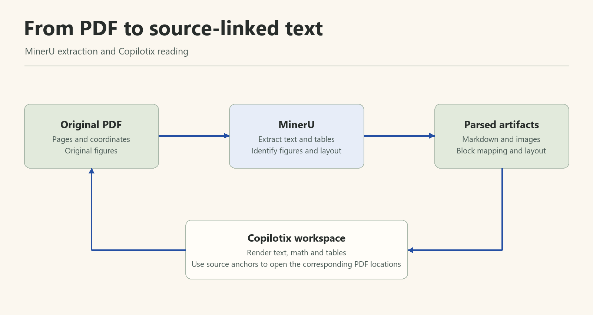

# 配置解析、翻譯與問答服務

**適用版本：1.2.0（含 Codex 接入）。** Copilotix 不提供或代付第三方 API 憑據；額度、費用、模型許可權和資料處理條款以服務商當前說明為準。

## MinerU：PDF 線上解析

1. 登入 [MinerU Token 管理頁](https://mineru.net/apiManage/token)申請 Token。
2. 在「設定 → 服務連線 → MinerU」貼上 Token 本身，不加 `Bearer` 字首。
3. 點選「測試連線」，成功後點選「儲存全部更改」。
4. 確認已驗證，再建立解析任務。

解析使用 MinerU 線上 v4 API，PDF 會上傳至其提供的地址；安裝包不含本地解析模型。

*處理流程示意圖：內容塊保留頁碼、座標框及來源資訊。這是概念圖，實際介面見閱讀工作台指南。*

## 翻譯來源與問答模型

| 服務 | 翻譯選擇項 | 論文問答選擇項 |
| --- | --- | --- |
| Qwen／千問 | `qwen-mt-plus` | `qwen-plus`、`qwen3.8-flash`、`qwen3.8-max` |
| DeepSeek | `deepseek-flash` | `deepseek-flash`、`deepseek-v4-pro` |
| Codex（可選） | 本機目錄中的文字模型 | 本機目錄中的文字／視覺模型 |
| Bing | 應用內無需 Key 的網頁翻譯 | 不支援 |
| 騰訊 TranSmart | 應用內無需 Key 的網頁翻譯 | 不支援 |

表中是 **1.2.0 預設選項**，不是對服務端可用性的保證；實際呼叫取決於帳號、地域、額度與服務商當前模型列表。Qwen／DeepSeek 不接受自定義模型名稱，舊自定義選擇回退到預設。Codex 從本機動態讀取模型目錄；已選模型消失時提示重新選擇，保留歷史，不自動替換。

### Qwen

1. 在[阿里雲百鍊控制檯](https://bailian.console.aliyun.com/)開通服務並建立 API Key。
2. 當前應用地址為 `https://dashscope.aliyuncs.com/compatible-mode/v1`，對應北京地域。地域不同的 Key、域名和模型列表不能混用，見[官方 API Key 文件](https://help.aliyun.com/zh/model-studio/get-api-key)。
3. 確認業務空間和許可權支援所選翻譯／問答模型。
4. 填入 Qwen 服務卡片，測試連線後儲存。

### DeepSeek

1. 在 [DeepSeek 開放平臺](https://platform.deepseek.com/api_keys)建立 API Key。
2. 確認餘額與呼叫許可權。
3. 填入 DeepSeek 卡片，測試連線後儲存。

當前應用地址為 `https://api.deepseek.com`，服務細節見[官方文件](https://api-docs.deepseek.com/)。

### Bing／TranSmart

可用於翻譯與回退，應用內無需填寫 Key，但仍需網路，且依賴第三方網頁介面。它們不提供論文問答功能。

### Codex：複用本機登入

1. 安裝 Codex CLI **0.159.x**，在本機執行 `codex login` 完成 ChatGPT 登入。
2. 在「設定 → 服務連線 → Codex」點選「重新整理連線與模型」。自動發現失敗時選擇實際的 `codex.exe`（不選 `.cmd` 啟動指令碼）。
3. 分別選擇翻譯模型、問答／解讀模型及推理強度；點選模型測試確認當前賬戶可以呼叫，再儲存全部更改。
4. 在「模型設定」啟用 Codex，並調整順序；預設仍關閉。希望優先使用 Codex 時將它移到首位。
5. 問答可在面板選擇 Codex；檔案卡總結和圖片解讀沿用其問答模型，識圖需要目錄標記支援圖片的模型。

這是本機 CLI 介面接入，**不是離線模型**：內容仍經 Codex 發往其配置的模型服務，受登入、網路、賬戶額度和模型許可權限制。Copilotix 不讀取登入令牌、不替你登入，也不更改個人 Codex 配置。PDF 解析仍使用 MinerU。

目錄可見不等於實際可呼叫。模型繁忙時可稍後重試或手動換模型；不會自動換 Codex 模型。Codex 限流時會自動降速並重試；仍失敗的翻譯段落會交給順序中下一個已啟用的服務，譯文中以「X 回退翻譯」標出，檔案卡也會改用已啟用的 Qwen／DeepSeek。若要確保內容僅發往 Codex，請在模型設定中關閉其他翻譯來源。連線異常先檢查 `codex login status`、CLI 版本及所選模型。該接入使用 [Codex App Server](https://learn.chatgpt.com/docs/app-server)，當前只啟用已驗證的 0.159.x 協議。

## 啟用、順序與共用憑據

在「設定 → 模型設定」啟用需要的翻譯服務，並設定順序。預設 **Qwen → DeepSeek → Bing → TranSmart**，跳過未啟用或沒有有效憑據的 Qwen／DeepSeek；失敗可能回退到後續已啟用來源。只希望向指定來源傳送文字時，請關閉其他來源並儲存。

問答共用相應服務在「服務連線」中儲存的 API 憑據，預設沿用翻譯服務商，面板可選擇已啟用的 Qwen／DeepSeek／Codex 與獨立問答模型。切換問答模型不修改翻譯模型。服務未啟用、憑據無效或未儲存時，問答會提示前往設定。

## 驗證與儲存

「測試連線」成功不等於已儲存，仍需點選「儲存全部更改」。單個欄位失敗時按提示修正。憑據儲存在 Windows 系統憑據儲存中，不寫入論文 `chat/`，也不包含在文庫備份裡。

使用程式即同意向已選服務傳送功能所需的論文文字及圖片；問答、總結與識圖直接傳送，無單獨確認步驟。Codex 測試連線成功會填入程式路徑，所選模型測試透過後顯示綠色「驗證成功」。

Codex 連線與模型驗證狀態會保留，重新啟動自動檢測連線。AI 問答的每條結果下方顯示實際模型、時間、用時及輸入／輸出／總 Token；服務未返回用量或舊記錄缺失時明確顯示未提供。
